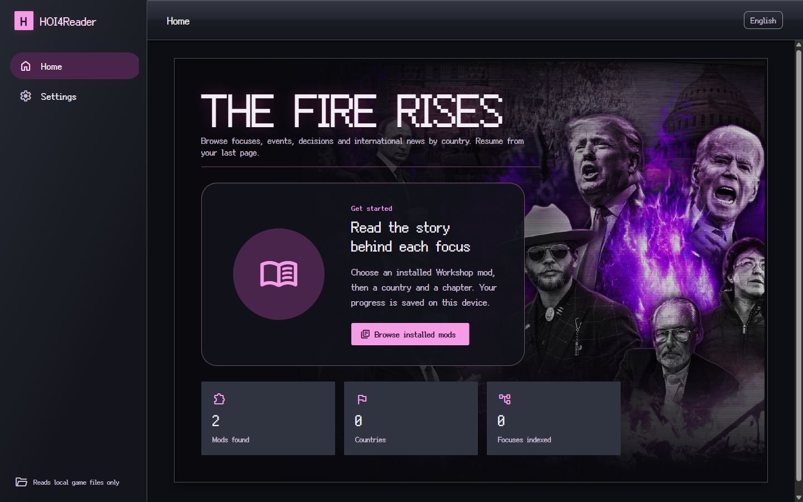

# HOI4Reader

**English** · [简体中文](docs/README.zh-Hans.md) · [正體中文](docs/README.zh-Hant.md) · [日本語](docs/README.ja.md)

A story reader for Hearts of Iron IV mods on desktop and Android. Pick a country, read its national focuses and events, and choose branches as the story unfolds.

## Home screen

HOI4Reader running with a local installation of The Fire Rises. The menu artwork is from the mod.



## Features

- Detects local Steam libraries and installed Workshop mods. You can also choose folders manually.
- Connects focuses, events, decisions, and world news using the mod's scripts. The reader shows dates and offers choices when the relevant war or political outcome cannot be simulated.
- Saves your place locally and lets you undo a branch choice.
- Shows locally installed illustrations and super events. Music history lets you replay tracks heard during reading. New story tracks interrupt by default, with an optional queue.
- Searches titles, body text, opening notes and response options in the current mod. Search results open as previews.
- Offers Material Design, The Fire Rises and The New Order themes. By default, the theme follows the last mod you played and starts in Material Design. English is the default language. Switch to Simplified Chinese, Traditional Chinese, or Japanese in Settings.

## Mod support

**The Fire Rises (TFR)** is the primary supported mod and has the most complete reading integration. The New Order can be discovered and indexed, with more limited route coverage. HOI4Reader interprets selected script structures. Some events still lack a verified trigger or date and appear as story leads.

## Run from source

Install Node.js, Rust and the [Tauri system prerequisites](https://v2.tauri.app/start/prerequisites/).

```sh
npm ci
npm --prefix frontend ci
npm run tauri:dev
```

Run `npm run tauri:build` to build for the current platform. For checks, run `cargo test` and `npm --prefix frontend test -- --watch=false`.

## Android

Build an installable ARM64 test APK with `npm run android:build` after setting up the [Tauri Android prerequisites](https://v2.tauri.app/start/prerequisites/#android) and installing Android SDK Platform 36. The APK declares Android 7.0 as its minimum installation version. Use an up-to-date Android System WebView.

Zip one Workshop mod folder per archive and keep its `descriptor.mod` at the ZIP root or inside a single top-level folder. Transfer the ZIP to your phone and choose **Import ZIP** on the mod selection page. Import the base mod and any supported submod, TNO Chinese translation, or TFR music add-on individually. You can optionally import a ZIP of the HOI4 game folder for fallback assets. Imported files and indexes live in the app's private storage.

**Download mod** on the Android mod selection page accepts a direct HTTPS URL to an importable ZIP. The app downloads it into private storage and imports it in the same library. For publisher pages and other archive formats, obtain the mod from its source and ZIP the extracted mod folder. [TFR on ModDB](https://www.moddb.com/mods/the-fire-rises) · [TNO on Nexus Mods](https://www.nexusmods.com/heartsofironiv/mods/34)

The app reads game and mod files from your local library. The bundled fonts include [Fusion Pixel](frontend/public/fonts/OFL.txt) and [Aldrich](frontend/public/fonts/OFL-Aldrich.txt).

## License

HOI4Reader's own code is licensed under the [GNU General Public License v3.0 only](LICENSE). Third-party assets and dependencies retain their respective licenses.
