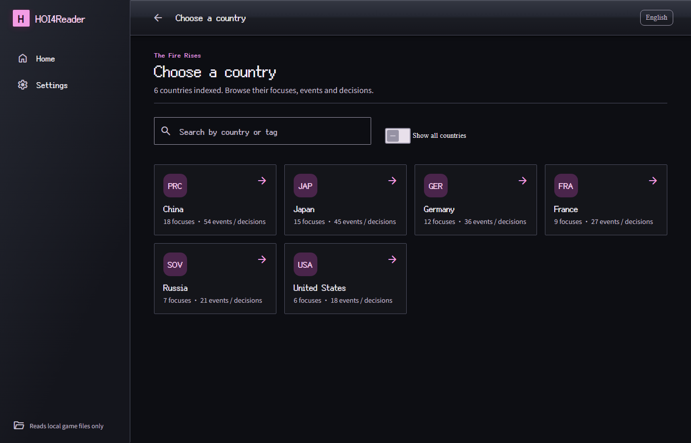

# HOI4Reader

[English](../README.md) · [简体中文](README.zh-Hans.md) · [正體中文](README.zh-Hant.md) · **日本語**

Hearts of Iron IV の MOD 向けストーリーリーダーです。国を選び、国家方針とイベントを読みながら分岐を選択できます。

- Steam ライブラリとインストール済みの Workshop MOD を検出します。フォルダーの手動指定も可能です。
- スクリプトに基づいて国家方針、イベント、ディシジョン、国際ニュースをつなぎます。進行状況を保存し、分岐選択を取り消せます。
- インストール済みの MOD から画像、スーパーイベント、音楽を読み込みます。新しい曲にすぐ切り替えるか、順番に再生するかを選択できます。
- Material Design と The Fire Rises のテーマを提供します。既定は英語で、簡体字中国語、繁体字中国語、日本語に切り替えられます。物語はインストール済みの翻訳を使用し、利用可能な場合は英語にフォールバックします。

**The Fire Rises（TFR）** が主な対応 MOD です。The New Order も検出・索引化できますが、ルートの対応範囲は限られています。一部のスクリプト条件は解析対象外です。

ソースから起動するには Node.js、Rust、[Tauri の動作要件](https://v2.tauri.app/start/prerequisites/) が必要です。プロジェクトで `npm ci`、`npm --prefix frontend ci`、`npm run tauri:dev` を実行します。パッケージは `npm run tauri:build` で作成できます。
