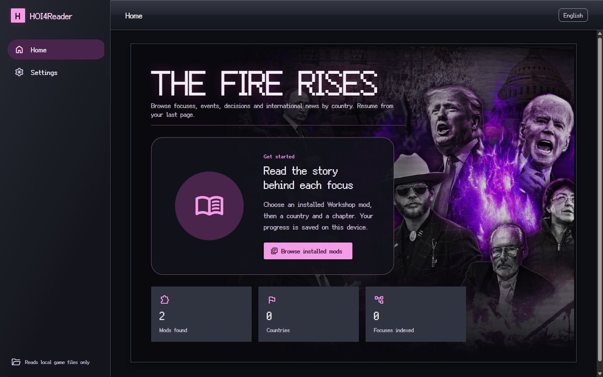

# HOI4Reader

[English](../README.md) · **简体中文** · [正體中文](README.zh-Hant.md) · [日本語](README.ja.md)

钢铁雄心 IV 模组剧情阅读器。选一个国家，沿国策和事件阅读，并决定剧情分支。

- 自动寻找本机 Steam 库和创意工坊模组，也支持手动指定目录。
- 按脚本串联国策、事件、决议和国际新闻。保存阅读进度，并允许撤回分支选择。
- 从本机模组读取插图、超事件和音乐。新曲默认立即切换，可在设置中改为排队播放。
- 支持 Material Design、The Fire Rises 和 The New Order 主题。首次启动使用 Material Design，默认跟随上一次游玩的模组，也可在设置里固定主题。
- 主页可搜索当前模组的标题、正文、开局提示和选项，也可在音乐回顾里重听阅读时播放过的音乐。
- 默认英语，也可选择简体中文、正体中文和日语。剧情译文取自已安装的本地化文件，缺译时优先显示可用的英文。

**The Fire Rises（烈焰升腾）** 是目前阅读流程最完善的模组。The New Order 可以扫描，路线支持较有限。部分游戏脚本条件仍有待解析。

从源码运行需安装 Node.js、Rust 和 [Tauri 系统依赖](https://v2.tauri.app/start/prerequisites/)。在项目目录执行 `npm ci`、`npm --prefix frontend ci`、`npm run tauri:dev`。安装包可通过 `npm run tauri:build` 构建。

## Android

安装 [Tauri 的 Android 构建依赖](https://v2.tauri.app/start/prerequisites/#android)和 Android SDK Platform 36 后，运行 `npm run android:build` 可构建 ARM64 测试 APK。

把模组分别压成 ZIP，保留每个模组的 `descriptor.mod`，传到手机后在模组选择页点**导入 ZIP**。本体、子模组、TNO 汉化包和 TFR 音乐包分别导入。也可单独导入 HOI4 游戏目录的 ZIP，供模组补用原版资源。导入文件和索引保存在应用专属目录里。

已有模组 ZIP 的 HTTPS 直链时，可在模组选择页点**下载模组**，下载完成会自动导入。发布页或 RAR 压缩包可先在浏览器获取、解压并压成 ZIP。 [TFR 发布页](https://www.moddb.com/mods/the-fire-rises) · [TNO 发布页](https://www.nexusmods.com/heartsofironiv/mods/34)

## 许可证

HOI4Reader 的自有代码采用 [GNU 通用公共许可证第 3 版（GPL-3.0-only）](../LICENSE)。第三方资源和依赖仍适用各自的许可证。
