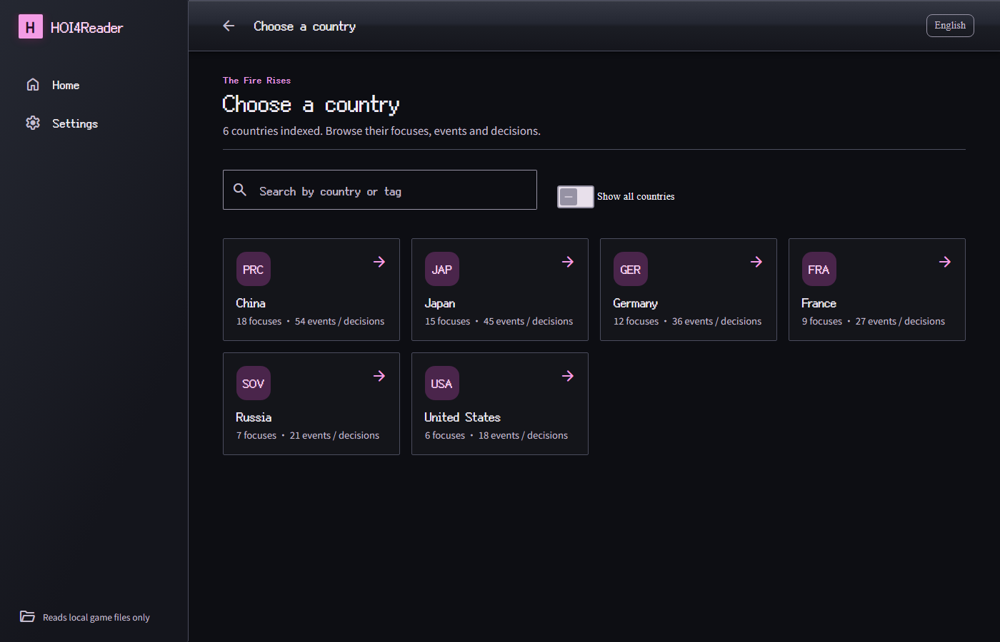

# HOI4Reader

[English](../README.md) · [简体中文](README.zh-Hans.md) · **正體中文** · [日本語](README.ja.md)

《鋼鐵雄心 IV》模組劇情閱讀器。選擇國家，沿著國策與事件閱讀，並決定劇情分支。

- 自動尋找本機 Steam 收藏庫與工作坊模組，也可手動指定資料夾。
- 依腳本串聯國策、事件、決議與國際新聞。儲存閱讀進度，並可撤銷分支選擇。
- 從本機模組讀取插圖、超事件與音樂。預設立即切換新曲，可在設定中改為依序播放。
- 提供 Material Design 與 The Fire Rises 主題。預設為英文，也可切換簡體中文、正體中文和日語。劇情譯文取自已安裝的本地化檔案，缺譯時會使用可用的英文原文。

**The Fire Rises（烈焰升騰）** 是目前閱讀流程最完整的模組。The New Order 可掃描，路線支援較有限。部分遊戲腳本條件仍待解析。

從原始碼執行需安裝 Node.js、Rust 與 [Tauri 系統依賴](https://v2.tauri.app/start/prerequisites/)。在專案目錄執行 `npm ci`、`npm --prefix frontend ci`、`npm run tauri:dev`。使用 `npm run tauri:build` 建置安裝程式。
